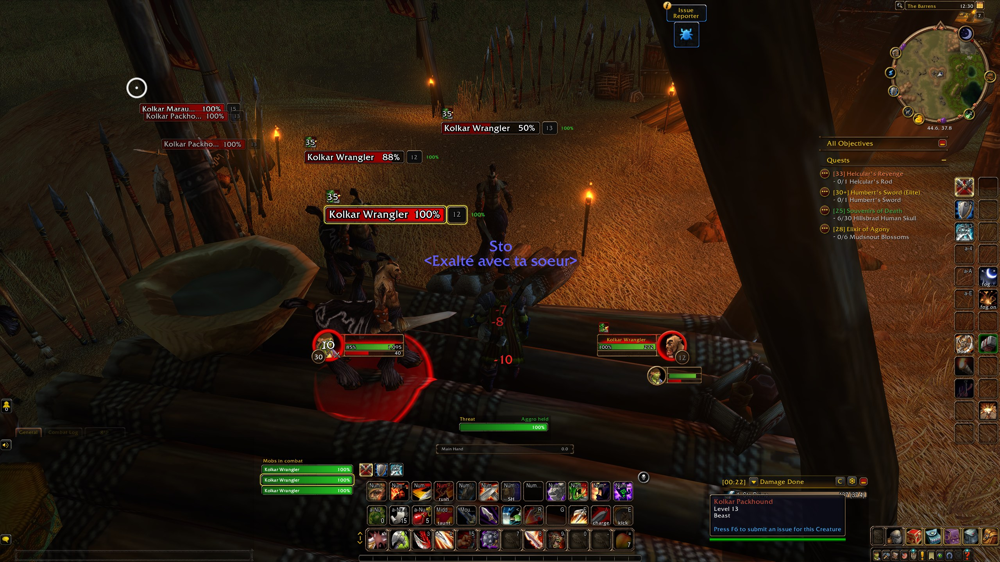
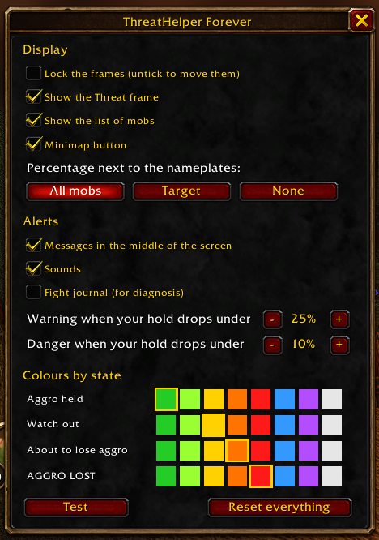

# ThreatHelper Forever

Threat tracker for tanks on **WoW Forever** (Interface 16001): warrior, paladin, druid in bear
form, any class that holds aggro.
It tells you, before it happens, that you are about to lose a mob, with a UI that looks like
the game's own.

*Version française plus bas.*

## Features

- **Your hold on every mob**: a discreet percentage next to the nameplate of each mob in combat
  with you. 100 % = the aggro is yours and nobody is close; it falls as someone closes in;
  0 % = lost. Colour by state (held, warning, danger, lost).
- **Threat frame**: a bar drawn like Forever's nameplates, with the name of the player closest
  to taking your target.
- **Mob list**: every mob in combat with you, sorted by danger (the one you are losing on top),
  your current target outlined.
- **Alerts** in the middle of the screen, with a sound: "Bob closing in", "DANGER", and
  "AGGRO LOST to Bob: TAUNT!" (it names the new holder, even outside your group).
- **Settings window** (minimap button or `/aggro`): lock/unlock the frames, what to show,
  alerts and sounds, the two thresholds, a colour per state, a 6-second test, reset.
- No false alarms on a fresh target you have not hit yet, nor at the pull.

## Screenshots

## Usage

1. Install, log in, show enemy nameplates (`V`).
2. Click the minimap button (or type `/aggro`) and untick "Lock the frames" to place the
   frame and the list, then lock them again.
3. Tank. Press "Test" in the settings to see every alert without a fight.

## Commands

`/aggro` (or `/threathelper`) opens the settings. Others: `lock`, `unlock`, `show`, `hide`, `warn <pct>`,
`danger <pct>`, `sound on|off`, `plate all|target|off|x <n>|y <n>`, `list on|off`, `minimap`,
`test`, `reset`, `help`. For diagnosis: `log on|off|clear`, `probe`, `debug on|off` (written
to the SavedVariables file).

## Compatibility and limits

- WoW Forever beta, Interface 16001, build 1.60.1.70450. English and French.
- Threat comes from the game's threat API (`UnitDetailedThreatSituation`,
  `UnitThreatPercentageOfLead`). On bosses the game may hide some values ("secret values"):
  the addon then falls back on the threat states. Not yet measured on a boss.
- Clicking a row of the list cannot target the mob: Forever forbids addons to target through
  a nameplate (checked in game). Click the nameplate itself.
- In raids the per-mob figures skip reading every raid member, to stay light.

## Development

The addon lives in `ThreatHelperForever/`; tests in `tests/` run outside the game:
`sh tests/check.sh` (LuaJIT tests, then luacheck with zero warnings). The in-game checklist is
in `docs/in-game-checklist.md`.

License: MIT (the code only; no Blizzard art is shipped).

---

## En français

Suivi de menace pour tous les tanks sur WoW Forever (guerrier, paladin, druide en forme d'ours…). Il prévient
avant que tu perdes un monstre.

- **Ta prise sur chaque monstre** : un pourcentage à côté de la barre de nom de chaque monstre
  en combat avec toi. 100 % = l'aggro est à toi, il baisse quand quelqu'un se rapproche, 0 % =
  perdue. Une couleur par état.
- **Cadre Menace**, **liste des monstres** triée par danger, **alertes** au centre de l'écran
  avec son, et **fenêtre de réglages** (bouton de minicarte ou `/aggro`) : verrou, affichages,
  alertes, seuils, couleurs, test, remise à zéro.
- Limites : non encore mesuré sur un boss ; cliquer une ligne de la liste ne cible pas le
  monstre (Forever l'interdit aux addons).
